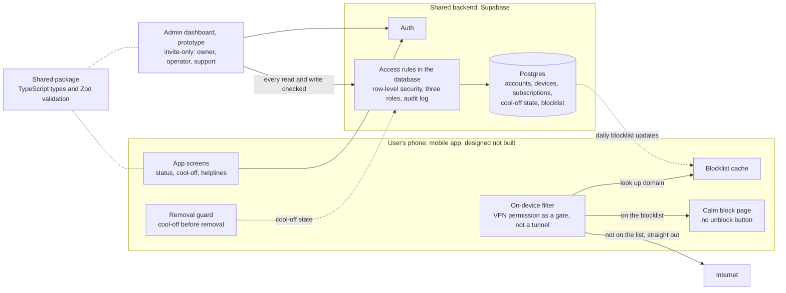

# GambleBlock Nordic

A harm-reduction app, designed to block gambling sites and apps on the phone behind a cool-off period that makes relapse harder.

**Status: prototype.** The research and the architecture are written up, and the admin dashboard runs as a prototype. The blocking on the phone is designed, not built. Nothing has launched, and the name is still a working title.

## Why this exists

Someone who has decided to stop gambling is most at risk in the craving moment, often in the evening. Denmark's self-exclusion register stops licensed gambling companies from letting them play. It does not stop the phone reaching unlicensed offshore casinos or crypto gambling, and their adverts still arrive.

Published research on relapse after self-exclusion is sobering: a block on its own is not a cure. So we are not trying to make gambling impossible. We want to add enough friction during the craving window for the urge to pass, as one piece of recovery next to treatment, counselling and helplines.

## The five-point test

We check the idea against five questions, from the five parts of every business in *The Personal MBA* by Josh Kaufman. For a prototype, some answers are still guesses, and we say which.

1. **Creates and delivers something of value**
   It puts friction between a craving and a bet. The design blocks gambling sites and apps on the phone, and removing the block means waiting out a cool-off period the user chose while calm.
2. **That other people want or need**
   People in Denmark, Sweden and Norway who are early in recovery, have decided to stop and fear a relapse. Sometimes a partner or parent buys it for them, so it has to work for a buyer who is not the user. This comes from our research. We still need to hear it from people in recovery.
3. **At a price they are willing to pay**
   Open. It is planned as a subscription, with yearly or monthly billing still undecided. The case for yearly: it is harder to cancel in a weak moment.
4. **In a way that satisfies the customer's needs and expectations**
   A phone app for the user and a web dashboard for the team, on one shared backend. The block is designed to run on the phone itself, so browsing is never routed through us. The designs are calm on purpose: no streaks, no "win" language, no unblock button on the block page, and helplines planned one tap away.
5. **So that it brings in enough profit to make continuing worthwhile**
   Open. It earns a full build only if people in recovery keep it on and pay for it. Finding that out is the goal of phase one.

## How we approached it

We are two co-founders. I lead the technical side, and my co-founder leads legal, customer research and funding.

- **Research before code.** We looked at what the self-exclusion register covers and what it misses, published research on relapse, and the blockers already on the market. The finding that shaped everything: the product is a friction layer next to treatment, never a replacement for it. We also wrote down what we are not: not therapists, not a medical device, not a cure.
- **Let the research correct us.** Our first draft signed people up to the self-exclusion register automatically. An outside app cannot do that, so the feature became a guided link where people enrol themselves.
- **Nordic first.** The closest comparable product is built for another market. Nordic languages, the national self-exclusion registers and the Nordic banks are where a local product can do better, so the plan starts in Denmark and adds Sweden and Norway next.
- **Ask how it fails.** Instead of asking how to stop people gambling, we asked how a gambling blocker fails. It fails in the craving moment, when the user removes it. So removal resistance is the core feature, not an extra. The user would pick a cool-off from a day to three months when installing. It can be made longer but never shorter, and it will be kept on the server, so uninstalling, reinstalling or switching phones won't reset it.
- **Agree the scope in writing.** Before any code, we wrote one document covering the architecture, phases, costs, risks and the decisions still open. The document calls its out-of-scope list its most important part, and sets one rule for both of us: during phase one, a new feature has to replace an existing one, not add to it.
- **Find the gates early.** An iPhone content-filter app needs Apple's approval before it can ship, so asking for it belongs at the start of the plan, not the end.
- **Privacy by design.** The team sees aggregated block counts only, never which sites a person tried to visit. Even the first owner account is set up with a one-time function that takes an ID, so no email or name ever lands in the code.
- **Specs before screens.** Each app has a written spec that covers tone as well as features: calm, plain, never preachy, and no gamified streaks for recovery. The specs drive the mockups in Claude Design and the build in Claude Code.

## Architecture

Two apps, one backend. A phone app for the user and an admin dashboard for the team share one Supabase backend and one package of types and validation rules, so the two apps can't drift apart. Access rules live in the database. The admin dashboard is invite-only, with three roles (owner, operator and support), row-level security on the data and an audit log of every change. It is designed for the team to manage the blocklist per country, handle support with a crisis queue that is never hidden, and pull reports.

On the phone, the block is designed to work like this. The app runs a local filter, using the system's VPN permission as a gate rather than a tunnel. Each domain is checked against a blocklist cached on the phone. A match shows a calm block page, and anything else goes straight out. No browsing passes through our servers. The server keeps only what it needs: accounts, devices, subscriptions, cool-off state and the blocklist.

## Stack

Built for the prototype:

- A monorepo with npm workspaces and Turborepo, TypeScript in strict mode
- Admin dashboard: Next.js 14 (App Router), Tailwind CSS and shadcn/ui, React Query with Server Components, Supabase SSR auth
- Mobile app: Expo (managed) and React Native, React Query and Supabase JS. The blocking features are still at the design stage.
- Shared package: TypeScript types and Zod schemas used by both apps
- Backend: Supabase, with Postgres, Auth and row-level security
- Hosting: Vercel for the dashboard, Supabase cloud for the backend

Designed, not built:

- A native blocking engine (Kotlin on Android, Swift on iOS) under a shared React Native UI. The principle: native where it matters, shared where it doesn't, boring everywhere else.
- Subscription billing through the App Store and Google Play

## What we learned

- **A block alone is not a cure, and the product has to say so.** That shaped the positioning: a friction layer for the hard moments that points to real help.
- **Let the first draft be wrong where it is cheap.** Our first version got the self-exclusion register wrong. Fixing it in a document was cheap. Fixing it after the build would not have been.
- **The hard part is staying on, not blocking.** Reviews of the closest comparable product show that people praise or blame the details that stop a bypass, not the blocking itself. So that is where the design spends its effort.
- **Platform gates set the timeline.** Without Apple's approval there is no iPhone app, so asking comes first.
- **Don't make two things match just for consistency.** Admin sign-in started with magic links, and the redirect chain broke on Windows and in several email clients. The admin moved to invite-only password sign-in, with links in the emails that go straight to our own site. The consumer app is designed to keep magic links. It is a different product with a different risk, so we deliberately keep the two apart.

## What's next

- Talk to people in recovery and the counsellors who work with them, and change the plan with what they say. The architecture document only becomes version 1.0 after those conversations.
- Ask Apple early for the approval a content-filter app needs.
- Then build phase one: Denmark, Android and iPhone, the block and the cool-off.
- Decide between yearly and monthly billing, and choose the final name.
- Settle a safer, no-access default for new team accounts before anyone beyond the founders joins.

## About this repo

This is a showcase — the README tells the story; the source code stays private.

If any of this helps you, take it. [Happy to talk it through](https://www.linkedin.com/in/brian-nanayakkara/).
